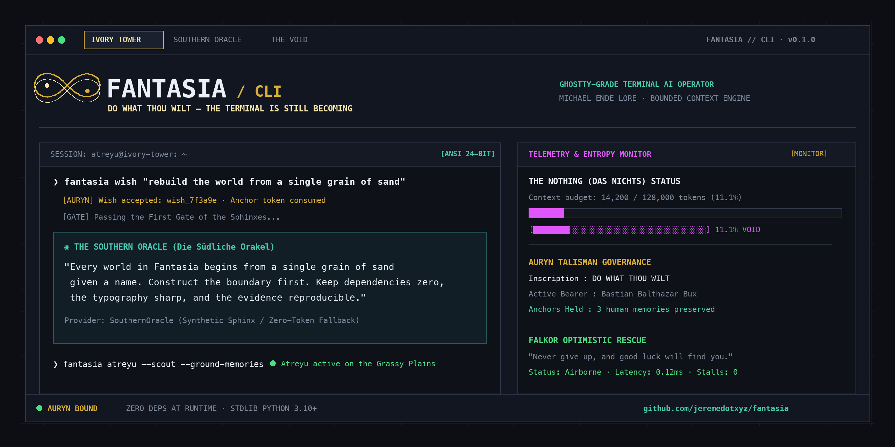

```
                                                                              
   FANTASIA / CLI                                                             
                                                                              
  ### Do what you wish. The terminal is still becoming.                       
                                                                              
  Ghostty-grade terminal AI operator · The NeverEnding Story · AURYN token     
  governor · Southern Oracle reasoning · bounded context preservation         
                                                                              
```

[](https://github.com/jeremedotxyz/fantasia/actions/workflows/checks.yml)
[](https://www.python.org/)
[](https://github.com/jeremedotxyz/fantasia)
[](https://github.com/jeremedotxyz/fantasia)
[](https://ghostty.org/)
[](https://github.com/jeremedotxyz/fantasia/actions)

[Start here](#-quickstart) · [Architecture](docs/architecture.md) · [Lore & Specs](docs/lore-and-specs.md) · [Operator guide](docs/operator-guide.md)



**Fantasia** is an interactive, terminal-native AI operator modeled after Michael Ende's *The NeverEnding Story* and styled in the high-fidelity visual aesthetic of **Ghostty**. It treats human prompts as wishes governed by **AURYN**, queries the **Southern Oracle** through multi-provider reasoning gates, and actively monitors context decay through **The Nothing** entropy gauge.

A terminal interface should not feel like an sterile web form. Ghostty taught the developer community that terminal ergonomics can be gorgeous, silky, and tactile; Michael Ende taught us that the reader is an active participant in the story. Fantasia unites both philosophies into a bounded, reproducible CLI engine.

> **DO WHAT THOU WILT.** In the book, every wish granted in Fantasia costs a human memory. Fantasia enforces this discipline in code: autonomous agents cannot drift into hallucinations without explicit human memory anchors.

---

## 🧭 Capabilities

| Subsystem | Lore Inscription | Working Capability | Telemetry & Artifacts |
| :--- | :--- | :--- | :--- |
| **AURYN Governor** | *"DO WHAT THOU WILT"* | State governor, token signer, and wish router | Cryptographic talisman signature, memory ledger |
| **Southern Oracle** | *The Sphinxes' Gaze* | Dual Sphinx reasoning gate (Gemini / OpenAI / Synthetic) | Gate passage status, zero-token offline fallbacks |
| **The Nothing** | *Das Nichts* | Context degradation & hallucination entropy monitor | 4-tier threat assessment, ASCII terminal radar |
| **Atreyu Scout** | *The Plains Hunter* | Autonomous filesystem reconnaissance and discovery | Structured artifact reports, dependency maps |
| **Falkor Recovery** | *The Luckdragon* | Optimistic retry loops, escape handlers | Stalled operation recovery, self-healing retries |
| **Ghostty UI** | *The Ivory Tower* | 24-bit TrueColor frames, macOS window controls, tabs | Silk-smooth rendering, zero runtime dependencies |

---

## 🚀 Quickstart

Fantasia is built with **zero runtime dependencies** beyond standard Python 3.10+:

```bash
# Clone the repository
git clone https://github.com/jeremedotxyz/fantasia.git
cd fantasia

# Run the Ghostty terminal demo
python3 -m fantasia.cli demo
```

### Direct Commands

```bash
# Submit an AURYN-grounded wish
python3 -m fantasia.cli wish "Rebuild the world from a single grain of sand"

# Consult the Southern Oracle directly
python3 -m fantasia.cli oracle "How do we isolate this boundary?"

# Dispatch the Atreyu reconnaissance scout
python3 -m fantasia.cli atreyu "Scan repository structure"

# Inspect The Nothing context entropy
python3 -m fantasia.cli nothing --tokens 42000
```

---

## 🏛 Project Structure

```
fantasia/
  ├── .github/workflows/
  │     └── checks.yml               # Automated CI matrix across Python 3.10-3.12
  ├── docs/
  │     ├── assets/
  │     │     ├── social-preview.png # 1280x640 share card generated from real telemetry
  │     │     └── social-preview.svg # Vector source
  │     ├── architecture.md          # Technical design & zero-dependency philosophy
  │     ├── lore-and-specs.md        # Mapping of Ende's book to terminal systems
  │     └── operator-guide.md        # Comprehensive flag & command reference
  ├── fantasia/
  │     ├── __init__.py              # Package metadata (v0.1.0)
  │     ├── agent.py                 # Atreyu scout & Falkor recovery
  │     ├── auryn.py                 # AURYN medallion & wish governor
  │     ├── cli.py                   # Argument parser & Ghostty entrypoint
  │     ├── nothing.py               # The Nothing entropy & context monitor
  │     ├── oracle.py                # Southern Oracle multi-provider bridge
  │     └── ui.py                    # 24-bit TrueColor Ghostty terminal renderer
  ├── scripts/
  │     └── generate_social_preview.py # Data-derived preview artwork generator
  ├── tests/
  │     ├── test_auryn.py            # Talisman signature & memory preservation tests
  │     ├── test_cli.py              # CLI integration & flag assertions
  │     ├── test_nothing.py          # Entropy thresholds & radar tests
  │     └── test_oracle.py           # Sphinx gate & fallback verification
  └── pyproject.toml                 # Package configuration
```

---

## 🔬 Scope and Bounds

- **Zero-Token Offline Guarantee**: When no API keys (`GEMINI_API_KEY`, `OPENAI_API_KEY`) are present, Fantasia activates its **Synthetic Sphinx Oracle** rather than crashing.
- **Bounded Exploration**: Atreyu's filesystem scout is bounded to 50 active artifacts per pass with explicit path exclusion to prevent directory tree explosion.
- **Terminal Compatibility**: The `GhosttyRenderer` supports TrueColor (24-bit ANSI) terminals (Ghostty, iTerm2, Kitty, Alacritty, WezTerm, macOS Terminal) and gracefully degrades on monochrome consoles.

---

## 🎨 Artwork and Licensing

The 1280 × 640 share card (`docs/assets/social-preview.png`) is generated directly from the package's real telemetry and TrueColor styling. Its editable vector source (`docs/assets/social-preview.svg`) is included. Regenerate with Python + Pillow:

```bash
pip install Pillow
python scripts/generate_social_preview.py
```

This repository has no license grant selected by its owner. Public visibility does not itself grant an open-source license.

---

*Do what you wish. Speak to the Oracle before The Nothing takes the rest.*
